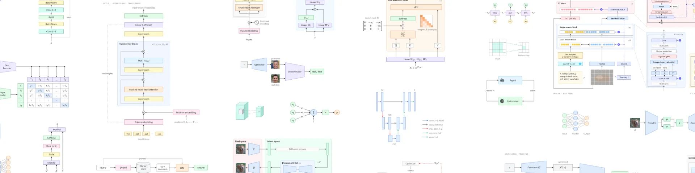

# nn-architectures



**[Open the site](https://yanexr.github.io/nn-architectures/)**

A collection of interactive model diagrams with short descriptions on each part. Any figure can be edited, exported, or used as the base for your own.

## Diagrams

The diagrams are written in [nn-diagram](https://github.com/yanexr/nn-diagram) as plain text files in [`content/models`](content/models). Any diagram can be opened in the [editor](https://yanexr.github.io/nn-architectures/editor/) via its **Edit** button, modified, and exported as SVG, PDF, or PNG for slides or papers.

## Adding a model

Found an error or want to add a model? Issues and pull requests are welcome. Each model lives in `content/models/<lab>/<model>/`:

- `model.json`: name, release date, parameter counts, links
- `README.md`: short explanation of how the model works
- `*.diagram.jsx`: one or more diagrams

Running the site locally requires [Node.js](https://nodejs.org) and [pnpm](https://pnpm.io):

```sh
pnpm install
pnpm dev
```

Then open http://localhost:3000.

## License

[MIT](LICENSE)
